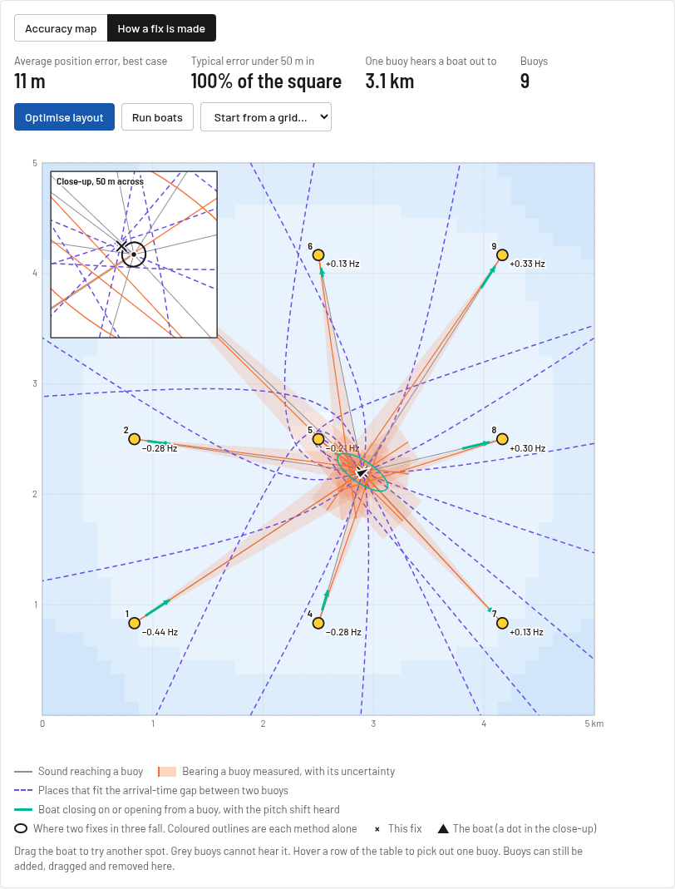
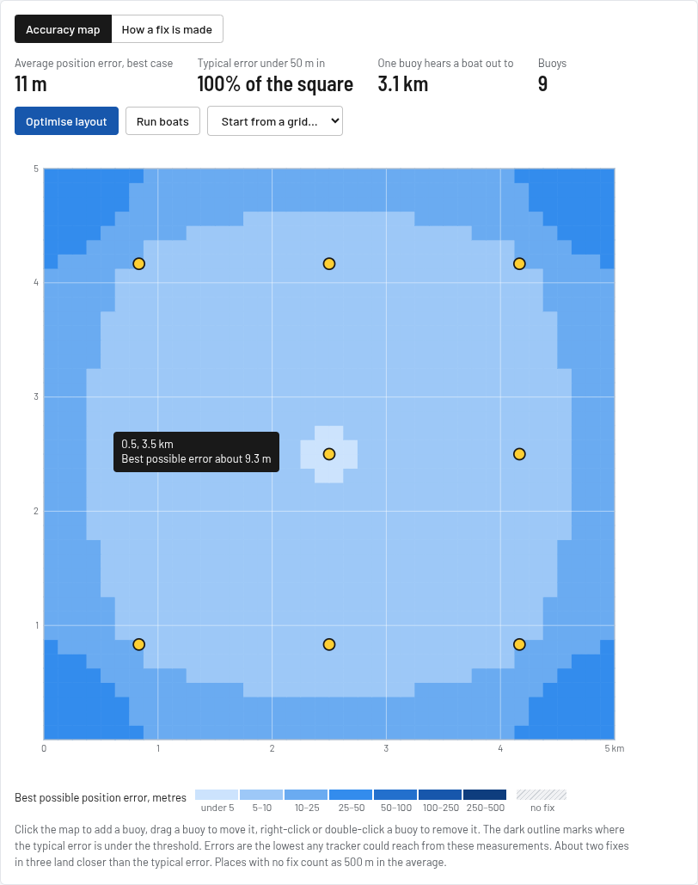

# DopplerBuoys

A simulator for one question: can a field of hydrophone buoys track small boats across a 5 km square by the sound of their engines?

Each buoy carries a ring of hydrophones. The simulator works out how well a set of buoys can place a boat, shows the working behind each position fix, and improves the buoy layout.



## Run it

You need [uv](https://docs.astral.sh/uv/). It fetches Python, numpy and scipy on the first run.

```
uv run sim.py
```

Then open http://127.0.0.1:8000.

```
uv run sim.py --check
```

runs the self-check, which takes about 15 seconds.

## What it does

- **Accuracy map.** Colours the square by the lowest position error a tracker could reach in each spot, for the current buoys and settings.
- **Layout.** Click the map to add a buoy, drag to move one, right-click to remove one. "Optimise layout" moves the buoys to lower the average error.
- **How a fix is made.** Drag a boat around the map and see the sound path to each buoy, each buoy's bearing, the curve that fits each arrival-time gap, and the pitch shift each buoy hears. A close-up shows where the lines cross. A panel underneath walks through the same fix in five steps with the numbers for every buoy.
- **Run boats.** Three boats cross the square, one of which stops and cuts its engine for five minutes. The page plots each fix against the true track and charts the error over time.
- **Settings.** Each assumption that drives the result is a slider: engine loudness and pitch, sea noise, loss with distance, hydrophones per buoy, compass error, timing error and engine pitch wobble.



## The three measurements

| Measurement | Where it comes from | What it needs |
|---|---|---|
| Bearing | Arrival times across one buoy's own hydrophones | A compass on the buoy |
| Doppler shift | Engine pitch heard at each buoy, compared between buoys | A few numbers sent from each buoy |
| Arrival time | When the sound reaches each buoy, compared between buoys | Synchronised clocks and raw audio sent to one place |

Each one can be switched off to see what it contributes.

## What it shows at the default settings

Nine buoys in a 3×3 grid:

| Measurements used | Average position error |
|---|---|
| All three | 11 m |
| Arrival time only | 11 m |
| Bearing only | 82 m |
| Doppler only | no useful fix |

- Arrival time between buoys does the positioning.
- Doppler mostly gives the boat's speed and heading. How much it helps with position depends on how steady the engine's pitch is.
- One buoy hears a boat out to about 3 km.
- A boat with its engine off is silent, so the track stops until it starts again.

These numbers move with the settings. Engine loudness, pitch wobble and timing error are estimates. Replace them with numbers from a field recording before relying on the results.

## How the model works

The model works on measurements, not audio.

1. A sonar equation gives the signal-to-noise ratio at each buoy: engine level, less the loss over distance, against sea noise.
2. Standard bounds turn that ratio into an error on each measurement. Compass error, timing error and pitch wobble are added on top.
3. The errors from every buoy combine into the lowest position error any tracker could reach (the Cramér-Rao bound). The map draws that.
4. A least-squares tracker fixes the boats in the live run from noisy measurements, and its error matches the bound.
5. An audio check generates the real waveform for a boat passing a buoy, measures pitch and bearing from it, and fails if the formulas in step 2 are wrong. It runs at a strong signal and at the weakest signal the model will use.

## What it leaves out

- Sound travels in straight lines through uniform water. Echoes off the seabed and surface are folded into the loss and timing error settings.
- Arrival timing assumes the processing corrects for the boat moving during each listen. Without that, a 10 kn boat smears arrival times by about 25 ms.
- Hydrophones on one buoy sit closer than half a wavelength, so they get no gain over sea noise. Bearings assume each hydrophone's own noise is independent.
- Only the pitch and bearing formulas are tested against generated audio. The arrival-time formula is not.
- Boats are told apart by engine pitch. Two boats with the same pitch are not handled.
- Buoys stay where they are placed.
- Sound takes up to 3 seconds to cross the square. The tracker ignores that delay.

## Where the defaults come from

- Loss over distance is set so one buoy hears a boat at about 3 km. [PNNL-19169](https://www.pnnl.gov/main/publications/external/technical_reports/PNNL-19169.pdf) (Matzner and others, 2010) found a small vessel "could reliably be detected from 3–5 km away" with one hydrophone in water 6 to 7 m deep.
- The same report measured about 126 dB from an outboard boat at 200 m. The default boat here comes to about 121 dB at 200 m.
- Sea noise of 70 dB is a moderate sea on the Wenz curves (Wenz, 1962, Journal of the Acoustical Society of America 34). It has not been checked for any site.
- The 16 dB signal threshold comes from the audio check. Below about 15 dB the pitch measurement breaks down.

## Files

- `sim.py`: the model, tracker, optimiser, self-check and web server.
- `index.html`: the page.
- `docs/design.md`: what the simulator is for and how it works.
